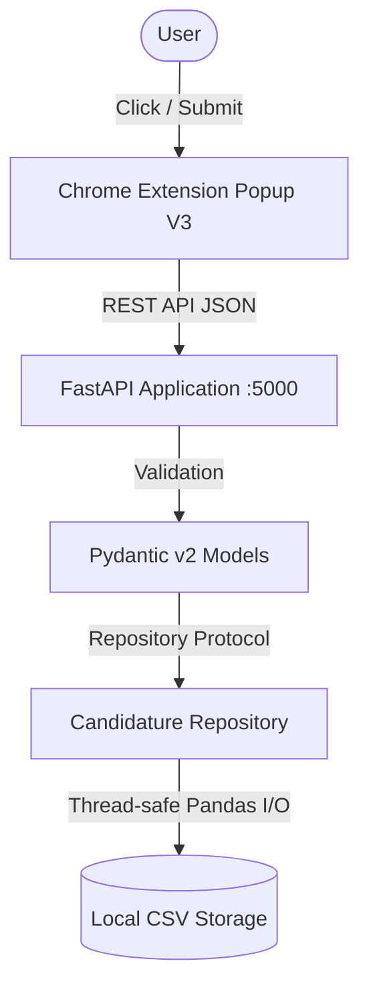

# 💼 Job Tracker

[](https://www.python.org/)
[](https://fastapi.tiangolo.com/)
[](https://developer.chrome.com/docs/extensions/mv3/intro/)
[](https://github.com/astral-sh/ruff)
[](http://mypy-lang.org/)

A modern, local-first job application tracking suite built with **FastAPI**, **Pydantic**, **Manifest V3 Chrome Extension**, and **Pandas**.

---

## 🏗️ Architecture & Technical Decisions



### Key Technical Choices
- **Repository Pattern**: Data persistence is isolated in `csv_repository.py`. Switching storage backends (e.g. SQLite / PostgreSQL) requires zero changes to the FastAPI routing layer.
- **Strict Type Safety**: Pydantic v2 schemas enforce validation and input sanitization (`ConfigDict`) across all endpoints.
- **Robustness & Error Handling**: Graceful exception mapping for concurrent file locks (`CSVLockedError` -> `HTTP 503`) and Excel BOM compatibility (`utf-8-sig`).
- **Code Quality Pipeline**: Enforces Ruff (formatting/linting), Mypy (type checking), and Pytest via pre-commit git hooks.

---

## 🚀 Quickstart & Local Setup

### 1. Prerequisites
- Python 3.10+
- Google Chrome (or Chromium-based browser)

### 2. Setup & Installation
```bash
# Clone repository
git clone https://github.com/loic-xu/job-tracker.git
cd job-tracker

# Copy environment & data templates
copy .env.example .env
copy data\candidatures.example.csv data\candidatures.csv

# Install dependencies
pip install -r requirements.txt
```

### 3. Run Backend API Server
```bash
py -m uvicorn server.main:app --reload --port 5000
```
> Or simply double-click `start_server.bat` to launch the server in the background.  
> The API will be live at `http://localhost:5000`. Interactive OpenAPI/Swagger documentation is available at `http://localhost:5000/docs`.

### 4. Load Chrome Extension
1. Open Google Chrome and navigate to `chrome://extensions`.
2. Enable **Developer mode** (toggle in top right).
3. Click **Load unpacked** and select the `chrome-extension/` directory.
4. Open the extension popup from your toolbar!

---

## 🛠️ Testing & Code Quality Assurance

```bash
# Install development tooling
pip install pre-commit pytest ruff mypy

# Enable local Git hooks
py -m pre_commit install
py -m pre_commit install --hook-type pre-push

# Execute automated Pytest test suite
py -m pytest tests/ -v
```

---

## 📁 Repository Structure

```
job-tracker/
├── server/               # FastAPI Backend & Business Logic
│   ├── main.py           # REST Routes, Middleware & Error Handlers
│   ├── csv_repository.py # Repository Pattern Data Access Layer
│   ├── models.py         # Pydantic v2 DTO Schemas
│   └── exceptions.py     # Domain Specific Exceptions
├── chrome-extension/     # Chrome Extension (Manifest V3)
│   ├── manifest.json     # Extension Manifest Configuration
│   ├── popup.html        # Semantic Accessible HTML
│   ├── popup.css         # Custom Dark Theme Glassmorphism CSS
│   └── popup.js          # Asynchronous Event-Driven DOM Manager
├── data/                 # Data Persistence Directory
│   └── candidatures.example.csv # Schema Data Seed Template
├── tests/                # Automated Pytest Suite
│   └── test_csv_repository.py
├── .env.example          # Environment Configuration Template
├── .pre-commit-config.yaml # Automated Quality Tooling Config
└── start_server.bat      # Windows Startup Script
```
