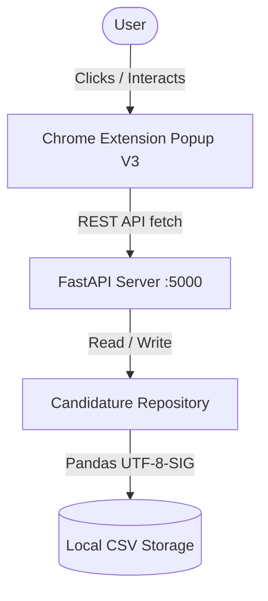

# 💼 Job Tracker

[](https://www.python.org/)
[](https://fastapi.tiangolo.com/)
[](https://developer.chrome.com/docs/extensions/mv3/intro/)

A modern, lightweight open-source tool to track your job applications locally (FastAPI, Manifest V3 Chrome Extension, CSV Storage).

---

## 🏗️ Architecture Overview



---

## 🚀 Quickstart & Local Setup

### 1. Prerequisites
- Python 3.10+
- Google Chrome (or any Chromium-based browser)

### 2. Setup & Installation
```bash
# Clone the repository
git clone https://github.com/loic-xu/job-tracker.git
cd job-tracker

# Create environment file from template
copy .env.example .env

# Create CSV data file from example template
copy data\candidatures.example.csv data\candidatures.csv

# Install backend dependencies
pip install -r server/requirements.txt
```

### 3. Run Backend Server
```bash
py -m uvicorn server.main:app --reload --port 5000
```
> The API will be live at `http://localhost:5000`. You can inspect interactive Swagger docs at `http://localhost:5000/docs`.

### 4. Load Chrome Extension
1. Open Google Chrome and navigate to `chrome://extensions`.
2. Enable **Developer mode** (toggle in top right).
3. Click **Load unpacked** and select the `chrome-extension/` directory.
4. Click the Job Tracker extension icon in your Chrome toolbar!

---

## 🛠️ Development & Quality Controls

This repository enforces strict linting, formatting, and type-checking standards:

```bash
# Install development and hook dependencies
pip install pre-commit pytest

# Enable local Git hooks
py -m pre_commit install
py -m pre_commit install --hook-type pre-push

# Run test suite
py -m pytest tests/ -v
```

---

## 📁 Repository Structure

```
job-tracker/
├── server/               # FastAPI REST API & CSV Data Access Layer
│   ├── main.py           # REST Endpoints & Exception Handlers
│   ├── csv_repository.py # Repository pattern & Pandas I/O
│   └── models.py         # Pydantic schemas
├── chrome-extension/     # Chrome Extension (Manifest V3)
│   ├── manifest.json     # Extension Configuration
│   ├── popup.html        # Semantic HTML layout
│   ├── popup.css         # Dark theme & Glassmorphism styles
│   └── popup.js          # REST Client & DOM State Manager
├── data/                 # Local Storage Directory
│   └── candidatures.example.csv # Example dataset schema
├── tests/                # Pytest Test Suite
│   └── test_csv_repository.py
├── .env.example          # Environment variables template
└── start_server.bat      # Windows silent startup script
```


