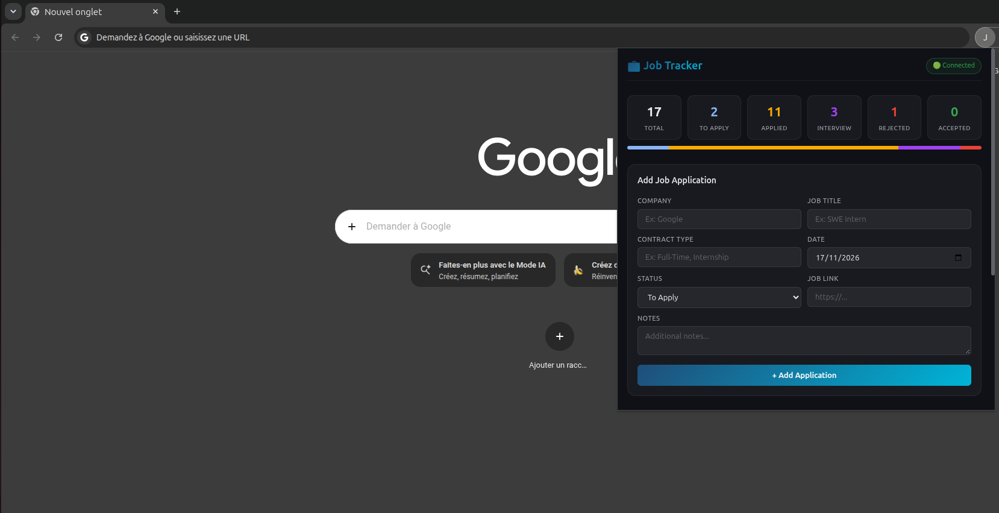
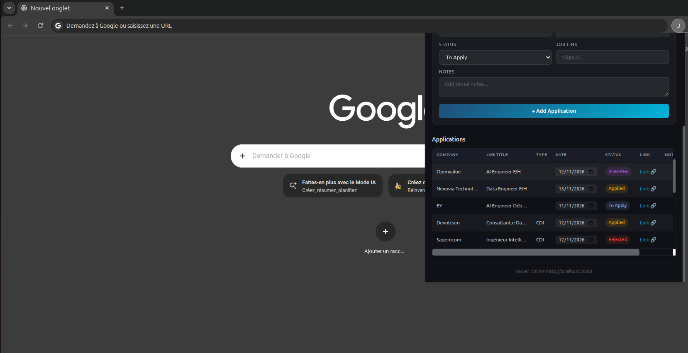
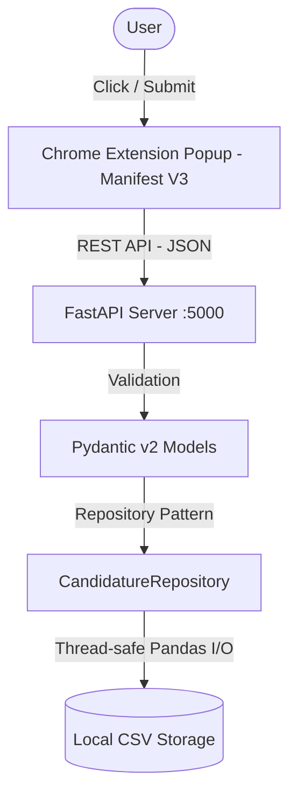

# 💼 Job Tracker

[](https://www.python.org/)
[](https://fastapi.tiangolo.com/)
[](https://developer.chrome.com/docs/extensions/mv3/intro/)
[](https://github.com/astral-sh/ruff)
[](http://mypy-lang.org/)
[](LICENSE)

A local-first job application tracker built with **FastAPI** and a **Chrome Extension (Manifest V3)**.  
Track, organize, and manage your job applications directly from your browser — all data stays on your machine.

<p align="center">
  
</p>
<p align="center">
  
</p>

---

## ✨ Features

- **Chrome Extension popup** — add a job application in one click from any job posting page (auto-fills the URL)
- **Dashboard stats** — real-time counters and progress bar by status (To Apply · Applied · Interview · Rejected · Accepted)
- **Interactive table** — inline date editing, one-click status cycling, delete with confirmation
- **REST API** — Endpoints for listing, creating, updating, and deleting applications, with Swagger documentation at `/docs`
- **Local-first** — all data stored in a single CSV file, no cloud dependency, Excel-compatible (`utf-8-sig`)

---

## 🏗️ Architecture



### Key Technical Choices

| Area | Decision | Rationale |
|------|----------|-----------|
| **Data access** | Repository Pattern (`csv_repository.py`) | Swap storage backend (SQLite, PostgreSQL…) with zero routing changes |
| **Validation** | Pydantic v2 `ConfigDict(str_strip_whitespace=True)` | Strict input sanitization across all endpoints |
| **Error handling** | `CSVLockedError` → `HTTP 503` | Graceful recovery when the CSV is open in Excel |
| **Code quality** | Ruff + Mypy + Pytest via pre-commit hooks | Automated formatting, linting, type checking, and testing |

---

## 🚀 Quickstart

### Prerequisites

- [Python 3.12+](https://www.python.org/downloads/)
- [uv](https://docs.astral.sh/uv/) (Python package manager)
- Google Chrome or any Chromium-based browser

### 1. Clone & Install

```bash
git clone https://github.com/loic-xu/job-tracker.git
cd job-tracker

# Copy environment & data templates
cp .env.example .env
cp data/candidatures.example.csv data/candidatures.csv

# Install dependencies
uv sync
```

### 2. Start the Backend Server

```bash
uv run uvicorn server.main:app --reload --port 5000
```

> The API is live at `http://localhost:5000`.  
> Interactive Swagger docs are available at `http://localhost:5000/docs`.

### 3. Load the Chrome Extension

1. Navigate to `chrome://extensions`
2. Enable **Developer mode** (top-right toggle)
3. Click **Load unpacked** → select the `chrome-extension/` folder
4. Click the extension icon in your toolbar — done!

---

## 🧪 Testing & Code Quality

```bash
# Install pre-commit hooks (runs Ruff + Mypy on commit, Pytest on push)
uv run pre-commit install
uv run pre-commit install --hook-type pre-push

# Run tests manually
uv run pytest tests/ -v
```

---

## 📁 Project Structure

```
job-tracker/
├── server/                    # FastAPI backend
│   ├── main.py                # Routes, middleware & error handlers
│   ├── csv_repository.py      # Repository pattern — data access layer
│   ├── models.py              # Pydantic v2 request/response schemas
│   └── exceptions.py          # Domain-specific exceptions
├── chrome-extension/          # Chrome Extension (Manifest V3)
│   ├── manifest.json          # Extension manifest
│   ├── popup.html             # Semantic HTML
│   ├── popup.css              # Dark theme with glassmorphism
│   └── popup.js               # Async event-driven DOM manager
├── tests/                     # Pytest test suite
│   ├── test_api.py            # API integration tests
│   └── test_csv_repository.py # Repository unit tests
├── data/                      # Data directory
│   └── candidatures.example.csv
├── docs/                      # Documentation assets
│   ├── demo_form.png
│   └── demo_list.png
├── .env.example               # Environment template
├── .pre-commit-config.yaml    # Code quality hooks
├── pyproject.toml             # Project metadata & dependencies
└── start_server.bat           # Windows quick-start script
```

---

## 💡 Architectural Trade-offs: Backend API vs. Browser-only Storage

A valid architectural question is: **why build a dedicated Python/FastAPI backend rather than a standalone Chrome extension using browser storage (`chrome.storage.local`)?**

### Pure Browser Extension (`chrome.storage.local`)
- **Pros**: Zero installation steps, no local server required, simple one-click distribution.
- **Cons**: Data remains sandboxed inside the browser profile and is permanently wiped if the extension is uninstalled. The user cannot directly open or modify the data in external spreadsheet tools (Excel, LibreOffice) or external data scripts.

### Decoupled Client-Server Approach (Current Design)
- **Data ownership & durability**: Application records persist directly on your file system in a standard, Excel-compatible CSV file. Even if the extension is removed, your job tracking history remains completely safe.
- **Interoperability**: The file can be opened, analyzed, or updated directly via desktop applications, or scripted with data analysis tools (Pandas, Jupyter notebooks).
- **Extensible REST API**: Isolating the data layer behind a REST API makes it easy to attach future clients (a desktop dashboard, automated job scraper scripts, or webhook notifications) or swap the storage engine (e.g. SQLite, PostgreSQL) without touching the Chrome extension.
- **Engineering practices**: Demonstrates end-to-end full-stack practices including input sanitization, the Repository pattern, automated testing, and type safety.

---

## 📄 License

This project is licensed under the [MIT License](LICENSE).

